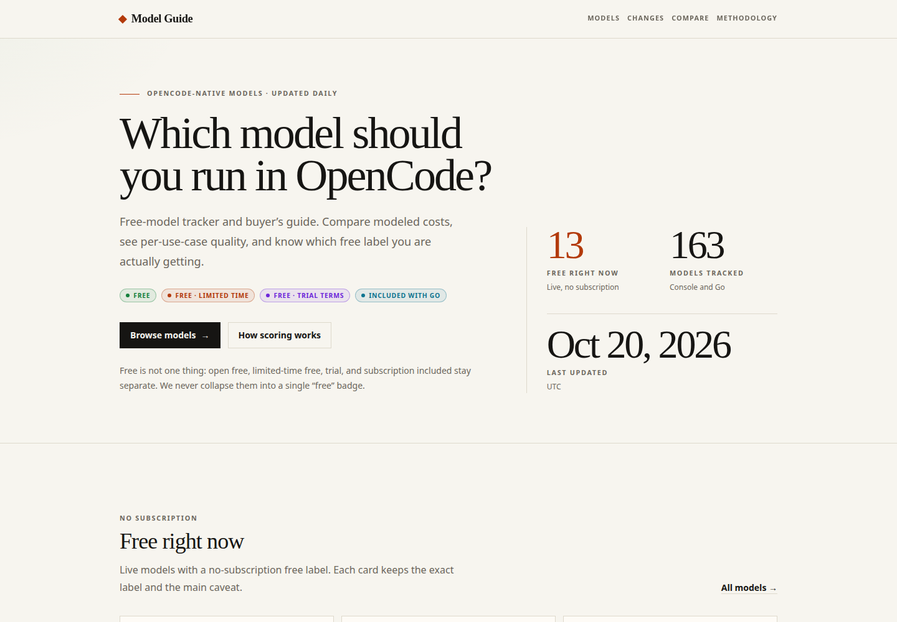

<p align="center">
  
</p>

<h1 align="center">OpenCode Model Guide</h1>

<p align="center">
  A free-model tracker and buyer’s guide for models available in OpenCode Console and Go / Go Plus.
</p>

<p align="center">
  <strong><a href="https://cjrutherford.github.io/opencode-model-guide/">Live site</a></strong>
  ·
  <a href="https://cjrutherford.github.io/opencode-model-guide/feed.xml">RSS</a>
  ·
  <a href="https://cjrutherford.github.io/opencode-model-guide/methodology">Methodology</a>
  ·
  <a href="https://cjrutherford.github.io/opencode-model-guide/evals">Experimental evals</a>
  ·
  <a href="https://cjrutherford.github.io/opencode-model-guide/health">Data health</a>
</p>

[](https://cjrutherford.github.io/opencode-model-guide/)

## What it is

OpenCode Model Guide tracks what is free, how it is free, what changed, and how models compare on
quality and modeled cost per task. It is a static site with a daily GitHub Actions pipeline: sources
are normalized into committed JSON snapshots, an append-only event log records changes, and Astro
builds the site and RSS feed. There is no database, server, analytics, or client-side data fetching.

The site never collapses every signal into one opaque score. Free labels, quality tiers, modeled
costs, provenance, and confidence stay separate. A separate [experimental
eval](https://cjrutherford.github.io/opencode-model-guide/evals) runs a fixed coding corpus against
free models and reports the results without feeding the composite.

## What it tracks

- **Console models** from the live OpenCode endpoint and models.dev.
- **Go / Go Plus models**, including subscription-included access.
- **Five labels:** `Free`, `Free · limited time`, `Included with Go`, `Free · trial terms`, and
  `Paid`.
- **Modeled task costs** from list prices and documented token profiles, not bills.
- **Per-use-case quality tiers** from public benchmarks, with coverage and confidence.
- **Access-level top picks** for free, Go-included, and pay-as-you-go models in each use case.
- **Change events:** model additions, free offers starting or ending, price changes, deprecations,
  and required-source failures.
- **Experimental local eval:** a fixed 12-task coding corpus, hidden tests, token and latency capture,
  and honest coverage. It is separate from every composite and tier.

Every displayed value carries a source and a date. The [methodology](https://cjrutherford.github.io/opencode-model-guide/methodology)
page documents the formulas, weights, tiers, and limitations.

## Experimental evals

The [`/evals`](https://cjrutherford.github.io/opencode-model-guide/evals) page publishes a first-party
local eval of free models. Twelve fixed tasks (6 TypeScript/JavaScript, 3 Python, 3 Go) run through
the real OpenCode agent loop or a direct-patch adapter, then hidden tests decide pass or fail. Results
include pass rate over completed tests, coverage, tokens per solved task, median duration, and run
provenance.

This is **not a public benchmark** and it does **not** affect composite scores, use-case tiers,
confidence, home-page top picks, or free-lane eligibility. The first official run is limited to live
Console free models, with one repeat. The page shows an honest empty state until a run exists. See
[`packages/eval/README.md`](packages/eval/README.md) for the harness, sandbox, and run commands.

## Data sources

The full inventory — URLs, fields, cadence, authority, failure policy, and legal notes — lives in
[`docs/sources.md`](docs/sources.md). In short:

- [models.dev](https://models.dev) for metadata and list pricing.
- OpenCode’s live Console and Go model endpoints for availability.
- OpenCode Console and Go docs for free terms, privacy, and subscription limits.
- SWE-bench, LMArena, Aider polyglot, and optional Artificial Analysis for quality.
- The Artificial Analysis Coding Index contributes to the agentic and everyday composites; its
  agentic and intelligence indices remain supplemental.
- Terminal-Bench is listed but skipped in v1 because it has no stable machine-readable leaderboard.
- A first-party local eval corpus, run manually against free models. It is experimental, separate
  from the composite, and not a public benchmark or external source.

## Local development

Node **22.22+** and pnpm **10.33.2** are required. In the T3 sandbox, pnpm is installed but not on
`PATH`:

```bash
export PATH="$HOME/.local/share/pnpm:$PATH"
pnpm install
pnpm dev
```

The dev server prints its local URL (normally `http://localhost:4321`). The site reads committed
files from `data/`; you do not need to run ingestion to browse it.

For a production-style base path:

```bash
SITE_URL=https://cjrutherford.github.io BASE_PATH=/opencode-model-guide pnpm build
BASE_PATH=/opencode-model-guide pnpm tsx scripts/check-links.ts
```

### Local secrets

Live ingestion, scoring, notification, and eval read `.secrets` automatically through Node’s
`--env-file-if-exists=.secrets`. Copy the tracked example:

```bash
cp .secrets.example .secrets
```

`.secrets` is gitignored and must never be committed. Tests use fixtures and `vi.stubEnv`; they do
not read the file or require network access. See [repository, Pages, and secret
setup](docs/setup-secrets.md) for generation, verification, and rotation.

## Scripts

| Command | What it does |
|---|---|
| `pnpm dev` | Start the Astro dev server. |
| `pnpm build` | Build the static site and run the route/postbuild checks. |
| `pnpm typecheck` | Run TypeScript and `astro check`. |
| `pnpm test` | Run unit tests. No network. |
| `pnpm test:watch` | Run tests in watch mode. |
| `pnpm validate:data` | Validate committed snapshot, benchmark, score, eval, and event data. |
| `pnpm ingest` | Fetch catalog and docs sources, classify free terms, write snapshot/history/events. |
| `pnpm score` | Fetch benchmark sources, resolve names, compute modeled costs and tiers. |
| `pnpm notify` | Send one ntfy summary for unsent events. Use `--dry-run` to print only. |
| `pnpm eval` | Run the experimental local eval. Requires Docker and `OPENCODE_API_KEY` for real attempts. |
| `pnpm eval:build-image` | Build the sandbox image used by the eval harness. |
| `pnpm eval:verify-corpus` | Verify all corpus tasks, hidden tests, and reference solutions. |
| `pnpm tsx scripts/check-links.ts` | Check every internal link in `apps/web/dist`. |

`pnpm notify` skips sending when `NTFY_TOPIC` is missing; the site can still build and deploy.
`AA_API_KEY` is optional. If it is absent, Artificial Analysis is marked skipped, its rows are
missing, and agentic/everyday confidence is lower. The affected models stay unrated rather than
receiving substitute scores. Eval runs are manual and free-only by default. The dedicated
`OPENCODE_API_KEY` is passed only to the disposable agent container so native OpenCode can satisfy
the free-tier client gate; the test container and network tunnel never receive it.

The full quality gate:

```bash
pnpm typecheck && pnpm test && pnpm validate:data && pnpm build
```

## Architecture

```text
models.dev ─┐
Console ────┼─→ ingest ─→ data/snapshot.json
Go ─────────┤              data/history/*.json
Docs ───────┘              data/events.jsonl
                                  │
SWE-bench ──┐                     │
LMArena ────┼─→ score ─→ data/benchmarks.json
Aider ──────┤              data/scores.json
AA (opt.) ──┘                     │
                                  ▼
                           Astro static build
                          ├─ site (GitHub Pages)
                          ├─ /feed.xml
                          ├─ /evals
                          └─ ntfy summary
```

A separate manual path writes eval results: `free Console models → eval (agent or direct-patch) →
data/evals.json → /evals`. It does not write snapshot, scores, history, events, or notify state.

Generated data files are committed so the site is reproducible and the pipeline is inspectable.
`data/evals.json` is generated only by a real eval run; the committed empty snapshot is the honest
no-run state. `data/aliases.json` is the one hand-edited data file. The full design is in
[`docs/plans/2026-10-19-opencode-model-guide-design.md`](docs/plans/2026-10-19-opencode-model-guide-design.md).

## Deployment

The site is published at **https://cjrutherford.github.io/opencode-model-guide/** from GitHub Pages.
The repository uses **Settings → Pages → Source: GitHub Actions**; there is no `gh-pages` branch.

[`.github/workflows/ingest.yml`](.github/workflows/ingest.yml) runs daily at 13:00 UTC and on manual
dispatch. It:

1. ingests the catalog and benchmark sources;
2. computes scores and validates the committed data;
3. commits changed `data/` files with `[skip ci]`;
4. builds with `actions/configure-pages` values for `SITE_URL` and `BASE_PATH`;
5. deploys the artifact to Pages;
6. sends ntfy changes and commits `data/notify-state.json`.

Scheduled runs skip the build and deploy when no data changed. A manual dispatch always deploys.
If a required source fails, the run stops before deploy and sends a high-priority failure alert.
If notification fails after deploy, the site remains live and the run fails visibly so the next run
can retry.

A separate [`.github/workflows/eval.yml`](.github/workflows/eval.yml) is manual-only. It builds the
sandbox, verifies the corpus, runs the selected eval mode, validates `data/evals.json`, commits the
result, and uploads run logs. It never receives `OPENCODE_API_KEY` outside the eval step and does not
deploy on its own.

For a fresh clone or fork, follow [`docs/launch-checklist.md`](docs/launch-checklist.md) and
[`docs/setup-secrets.md`](docs/setup-secrets.md). Never commit `NTFY_TOPIC`, `AA_API_KEY`,
`OPENCODE_API_KEY`, or `.secrets`.

## Freshness

The data pipeline runs every day at **13:00 UTC** and commits a new snapshot. The daily commit also
keeps the repository active, which prevents GitHub from disabling the schedule after long inactivity.

Force a run:

```bash
gh workflow run ingest.yml
gh run list --workflow ingest.yml --limit 3
```

Watch the run and the Pages deployment:

```bash
gh run watch
```

The footer of every page shows the newest source or score timestamp. `/health` shows per-source
status, staleness, unmatched benchmark names, and source conflicts.

## Contributing

Read [`CONTRIBUTING.md`](CONTRIBUTING.md) before changing code or data. Pick a slice from the
[tracker](docs/slices/README.md), claim it, and keep changes inside that slice’s file ownership.

The short version:

```bash
git switch -c slice/SXX-short-name
pnpm install
pnpm typecheck && pnpm test && pnpm validate:data && pnpm build
```

Do not hand-edit `data/snapshot.json`, `data/benchmarks.json`, `data/scores.json`,
`data/evals.json`, or `data/events.jsonl`. Schema changes require a tracker note and a version bump.

## Disclaimer

This project is not affiliated with OpenCode or Anomaly. Prices, free offers, and model availability
change frequently; every figure on the site carries a source and a date. Modeled costs are estimates,
not invoices.
